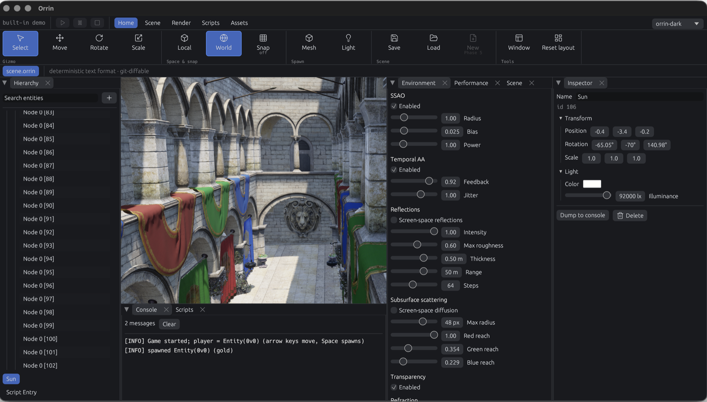

I merged the visual additions branch today. It's 236 files and about 42,000 lines added, which makes it by far the biggest thing that's landed in Orrin so far. It's been in progress for a couple of weeks and it touches almost everything: the renderer, the editor, the scene format, and the way lights are authored.

The screenshot above is Sponza running in the engine.

## The render graph

Everything else in this PR depends on this one, so it's worth explaining properly.

Before, a frame was hand-wired. Somebody had to know that this pass writes to that image, so this barrier goes here, with that layout transition, and those usage flags on the image at creation time. Every new pass meant editing that wiring by hand, and getting it wrong means a validation error at best and a corrupted frame or a device loss at worst.

Now passes declare what they read and what they write in `frame::declare`, and the graph derives the rest — execution order, image layouts, barriers, and `ImageUsage` flags. Nothing hand-wires a frame anymore. `frame.rs` is 1,423 lines and it is now the single definition of what a frame is in Orrin.

The part I'm most pleased with is that the graph is device-free, meaning it can be compiled and inspected without a GPU. So CI asserts the whole barrier plan against a golden file - 2,738 lines describing 893 barriers. If a change to one pass silently reorders or drops a barrier somewhere else, the diff shows up in a pull request instead of as a flicker on somebody's machine six weeks later.

## Around 30 new passes

This is the bulk of the diff, roughly 34,000 lines. The short list of what the renderer can do now that it couldn't before:

- **Shadows** - cascaded shadow maps for directional lights, point and spot shadows, plus contact shadows for the short-range detail that shadow maps always miss.
- **Anti-aliasing** - TAA with motion vectors, and improved geometric specular anti-aliasing.
- **Reflections** - screen-space reflections, GGX sampling, and IBL with spherical-harmonic irradiance for the skybox.
- **Camera and exposure** - bloom with histogram-based auto-exposure, depth of field, and motion blur.
- **Transparency** - weighted-blended OIT, screen-space refraction, and alpha-to-coverage cutouts.
- **Volume and surface detail** - froxel volumetric fog, subsurface scattering, parallax mapping, and projected decals.

The shader tree went from about 4 files to about 40. That only works because of shared includes - `brdf.glsl`, `shading.glsl` at 1,404 lines, `cascades.glsl`, `parallax.glsl`, `decals.glsl` - so the forward, OIT, refraction and prepass shaders can't quietly drift apart from each other. Four copies of the same lighting maths is how you end up with transparent objects that are lit subtly differently from opaque ones.

## Lights have real units now

Lights used to be arbitrary numbers you turned up until the scene looked right. Now they carry real photometric units: lux for directional lights, lumens for point and spot lights, and cd/m² for ambient and emissive. One world unit is one metre. Environments are calibrated to a stated sky luminance instead of being multiplied by a slider.

The upside is that a light rig is now portable and physically meaningful - you can look up what a real overcast sky is and type it in, and the result is correct rather than approximately correct. The downside is that this silently recalibrates every scene that was authored under the old system, along with the auto-exposure histogram window. If something you made looks blown out or too dark after this merge, that's why, and it's expected.

## The editor

Alongside the renderer work the editor got a real pass:

- Docking, via `egui_dock`, so you can arrange the tools instead of accepting the layout I picked.
- A ribbon, and Lucide icons throughout.
- User themes, with your preferences persisted between sessions.
- A hierarchy tree with drag-to-reparent, search, row banding, and per-row delete.

Note that this is a barebones version of the editor and a better-looking one will come down the line.

## Scenes and data

The transform hierarchy is real now - `Parent` and `WorldTransform` components, parent links that persist through save and load, recursive despawn, rigid-attachment collision, and the whole thing exposed to the C# scripting API. There's a test where a child orbits its spinning parent, which is a satisfying thing to watch pass.

There's a new `orrin-registry` crate handling reflection, the component registry and the text scene format, about 2,100 lines with tests, plus an `orrin-macros` derive to go with it. glTF import landed in `scene/model.rs`, deliberately split so the parsing half can be tested in CI without a GPU.

## What's next

I think that the renderer is in a satisfactory state aside from optimizations. I want to take a break from this side of the engine and move on to more engine-side features, getting this whole game engine usable. I will return to the renderer near the end of the year. And I will also do some minor features in the meantime.

If you want to look at the code it's all in the repo, and PR #65 has the full breakdown. Suggestions and bug reports are welcome on the Discord or as GitHub issues - I'm active on both.
